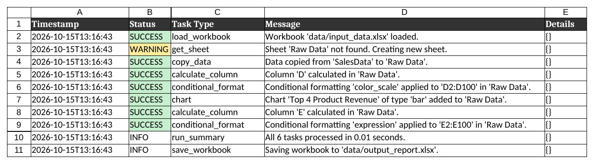
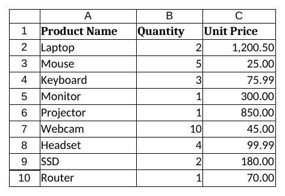
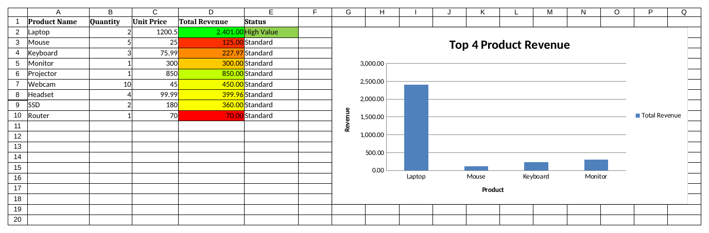

# Week 10 — LabX ADV: Advanced Spreadsheet Automation & Agentic Workflows

**ชื่อ:** สาริษฐ์ บุตรช่วง  **รหัสนักศึกษา:** 663380365-3
**รายวิชา:** SP352301 Script Programming (1/2569)

"Agentic Spreadsheet Processor" — `SpreadsheetAgent` อ่านรายการ task จาก `configs/example_spreadsheet_config.json`
แล้วจัดการไฟล์ Excel ด้วย `openpyxl` ตามลำดับ (คัดลอกข้อมูล, ใส่สูตร, conditional formatting, สร้างกราฟ)
และบันทึกทุกขั้นตอนลงชีต **Audit Log** ในไฟล์ `data/output_report.xlsx`

## ผลลัพธ์ (Screenshots ของ `output_report.xlsx`)

### ชีต Audit Log
บันทึกการทำงานของ agent ทุก task พร้อมสถานะ (SUCCESS / WARNING / INFO)


### ชีต SalesData
ข้อมูลต้นฉบับจาก `input_data.xlsx`


### ชีต Raw Data
- คอลัมน์ **D Total Revenue** = `=B*C` พร้อม color scale (แดง → เหลือง → เขียว)
- คอลัมน์ **E Status** = `=IF(D>1000,"High Value","Standard")` ไฮไลต์สีเขียวเมื่อเป็น High Value
- กราฟแท่ง **Top 4 Product Revenue**



## Tasks ใน config

| # | type | สิ่งที่ทำ |
|---|------|----------|
| 1 | `copy_data` | คัดลอก `SalesData` → `Raw Data` |
| 2 | `calculate_column` | D = Total Revenue (`=B{row}*C{row}`) |
| 3 | `conditional_format` | color scale ที่ D2:D100 |
| 4 | `chart` | Bar chart จาก D1:D5 / หมวดหมู่ A2:A5 วางที่ G2 |
| 5 | `calculate_column` | E = Status (`IF` > 1000) |
| 6 | `conditional_format` | expression `$E2="High Value"` → พื้นเขียว |

## สิ่งที่แก้จากโค้ดตัวอย่างในใบงาน

1. **`main.py`** – `from .src.utils import ...` ใช้ไม่ได้เมื่อรัน `python main.py` (ImportError) จึงเปลี่ยนเป็น `from src.xxx import ...` และให้ทำงานจากโฟลเดอร์โปรเจกต์เสมอ
2. **`config_parser.py`** – เดิมบังคับให้ทุก task มี `sheet` แต่ `copy_data` ใช้ `source_sheet`/`dest_sheet` → config ตัวอย่างโหลดไม่ผ่าน จึงตรวจแยกให้ `copy_data`
3. **`spreadsheet_agent.py`**
   - เพิ่ม `import json` (ใช้ใน `_add_audit_log_sheet` แต่ไม่ได้ import)
   - เงื่อนไข `expression` ใช้ `Rule(type="expression", ...)` + fill แบบ solid (โค้ดเดิมส่ง argument ผิดรูปแบบให้ `conditional_formatting.add`)
   - `copy_data` จะไม่สร้างชีตต้นทางเปล่า ๆ ถ้าหาไม่เจอ แต่จะบันทึก ERROR แทน
   - บันทึก run summary / save ก่อนสร้างชีต Audit Log เพื่อให้ไปปรากฏในชีตด้วย และใส่สีตามสถานะ
4. **config** – `category_range` เปลี่ยนจาก `A1:A5` เป็น `A2:A5` ไม่อย่างนั้นหัวคอลัมน์ "Product Name" จะกลายเป็นแท่งแรกและชื่อสินค้าเลื่อนผิดตำแหน่ง
5. เพิ่ม **`create_input_data.py`** สำหรับสร้าง `data/input_data.xlsx` ตามข้อมูลในใบงาน

## วิธีรัน

```bash
pip install openpyxl
python create_input_data.py   # สร้าง data/input_data.xlsx (มีไฟล์ให้แล้ว รันซ้ำได้)
python main.py                # ได้ data/output_report.xlsx
```

## โครงสร้างโฟลเดอร์

```
week10/
├── src/
│   ├── __init__.py
│   ├── spreadsheet_agent.py       # ตัว agent: dispatch task และจัดการ Excel
│   ├── config_parser.py           # โหลดและตรวจสอบ config
│   ├── utils.py                   # logging และ helper
│   └── google_sheets_utils.py     # placeholder สำหรับ Google Sheets API
├── configs/
│   └── example_spreadsheet_config.json
├── data/
│   ├── input_data.xlsx            # ข้อมูลตัวอย่าง (ชีต SalesData)
│   └── output_report.xlsx         # ผลลัพธ์
├── screenshots/                   # ภาพสำหรับส่งงาน
│   ├── Audit_Log.png
│   ├── SalesData.png
│   └── Raw_Data.png
├── AllCode.md                     # รวมโค้ดทั้งหมด
├── create_input_data.py
├── main.py
├── .gitignore
└── README.md
```
